+++
date = 2024-12-01T00:00:00-06:00
draft = false
title = 'A Brisk Tour of Elliptic Curves'
math = true
tags = ['math', 'algebraic geometry', 'cryptography']
+++

*This post is adapted from the paper I wrote for the 2024 University of Chicago Math REU. The original PDF is [available here](http://math.uchicago.edu/~may/REU2024/REUPapers/Padmanabhan.pdf).*

Mathematicians and computer scientists have likely encountered the topic of elliptic curves in their work and research. This expository article, directed to those unfamiliar with the topic, serves as a gently guided tour of the subject of elliptic curves.

<!--more-->

An easily digestible definition of elliptic curves is the following:


Let \(K\) be a field with characteristic not equal to 2 or 3 (i.e. \(2 \neq 0\) and \(3 \neq 0\)). An *elliptic curve* is a set of solutions \((x, y)\) to an equation
\[ y^2 = x^3 + ax + b, \]
with coefficients \(a, b \in K\) satisfying \(4a^3 + 27b^2 \neq 0\).


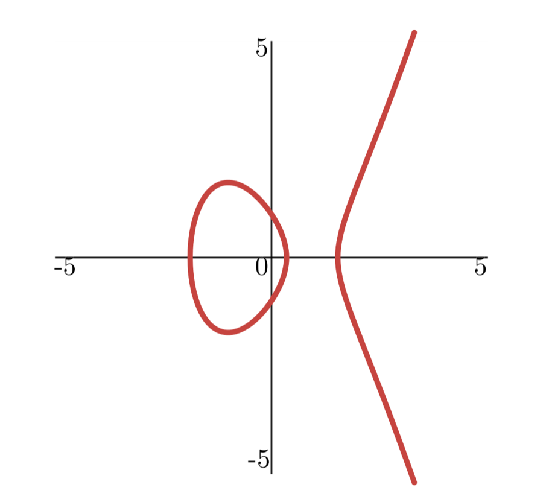
**Figure 1.** *An elliptic curve.*

It is quite easy to state, but this definition seems completely random, with absolutely no insight into what makes these objects special and worth our study. This paper is devoted to answering this question: *why are elliptic curves special?*

In the course of this article, we will demonstrate two potential answers to this question. In §1, we zoom out to a more general perspective and realize that elliptic curves are a very special case in a general field of study—algebraic geometry. In §2, we show that elliptic curves have a natural, nontrivial abelian group structure that is both interesting to study in itself and finds greatly useful applications in cryptography. It is my hope that each of these answers will help motivate the rich and beautiful study of elliptic curves to the interested reader.

Throughout, we assume the reader has some basic knowledge of abstract algebra, particularly basic group and ring theory. Terms such as "group", "ring", "ideal", "prime ideal", "integral domain" should be familiar. We point readers looking for a more thorough introduction to the subject to Silverman's excellent textbook *The Arithmetic of Elliptic Curves* [1]; many of the proofs in this work are from his book. Finally, certain results, such as Riemann-Roch, are stated without proof. References have been included to standard proofs, most of which are far beyond the scope of this article.

## 1. The perspective of algebraic geometry

One possible way to understand the significance of elliptic curves—these specific polynomial equations—is to find an equivalent characterization of these objects, allowing us to view them through a new lens. As we shall soon see, by temporarily zooming out to a more general view of algebraic sets and curves, the particularly special qualities of elliptic curves will become clearer.

To accomplish this, let us forget about the specific equations defining elliptic curves and consider the solutions sets to general polynomial equations. The field of mathematics that systematically studies these objects is *algebraic geometry*. Let's start our journey to the first answer by laying out some of the basic concepts of algebraic geometry.

### 1.1. The basics of algebraic geometry

Let \(K\) be an algebraically closed field. As pointed out above, we are concerned with algebraically characterizing the geometry of the solutions to polynomial equations. Thus, we need some sort of coordinate space in which we can investigate the zeros of polynomials.


The \(n\)-dimensional vector space \(K^n\) is called *\(n\)-dimensional affine space*, alternatively denoted \(\mathbb{A}^n\). The special cases \(\mathbb{A}^1\) and \(\mathbb{A}^2\) are the *affine line* and *affine plane* respectively.


Now, with a suitable setting, we can start characterizing polynomial equations. Working in \(\mathbb{A}^n\), our polynomials will have \(n\) variables \(x_1, \ldots, x_n\). To simplify, denote the polynomial ring \(K[x_1, \ldots, x_n]\) by \(K[X]\). We can move all terms to one side in any polynomial equation, so we need only study the sets of roots of polynomials.


An *affine algebraic set* is a set \(V \subseteq \mathbb{A}^n\) of the form
\[ V = \left\{ x \in \mathbb{A}^n \;\middle|\; f(x) = 0 \text{ for all } f \in I \right\}, \]
for some ideal \(I \subseteq K[X]\). The *ideal of \(V\)* is the set
\[ I(V) := \left\{ f \in K[X] \;\middle|\; f(x) = 0 \text{ for all } x \in V \right\}. \]



An affine algebraic set \(V\) is called an *affine variety* if the ideal \(I(V)\) is a prime ideal in \(K[X]\). We then define the *affine coordinate ring*
\[ K[V] := K[X]/I(V). \]
Necessarily, \(K[V]\) is an integral domain.


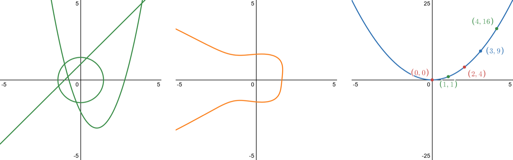
**Figure 2.** *Left to right: An affine algebraic set, an affine variety, and \(\mathbb{Q}\)-rational points on an affine variety.*

We often want to study the points of varieties whose coordinates fall into a specified subfield \(L \subseteq K\). Such points are called *\(L\)-rational*, and the set of \(L\)-rational points in the variety \(V\) is denoted \(V(L)\).

### 1.2. Projective geometry

We now turn to the word "projective". As we shall see, this term makes our lives as geometers significantly easier. One of the problems with geometry are all the pesky exceptions in our results; for example, consider the following two familiar propositions in Euclidean space:

1. Every pair of non-parallel lines intersects at exactly one point.
2. The zero-set of a degree \(n\) polynomial and a degree \(m\) polynomial have at most \(nm\) intersections.

And now their projective equivalents:

1. Every pair of lines intersects at exactly one point.
2. The zero-set of a degree \(n\) polynomial and a degree \(m\) polynomial have exactly \(nm\) intersections (counting multiplicity).

Somehow, the results are much simpler and cleaner! The key intuition behind projective geometry is to, in a sense, complete our regular affine space by adding *points at infinity*. Consider the following illustrative example.


Let us look closer at parallel lines. Suppose you have two lines in \(\mathbb{R}^2\), one through \((0, 1)\) and \((1, 1)\), and one through \((1, 0)\) and \((1, 1)\). These lines intersect at \((1, 1)\).

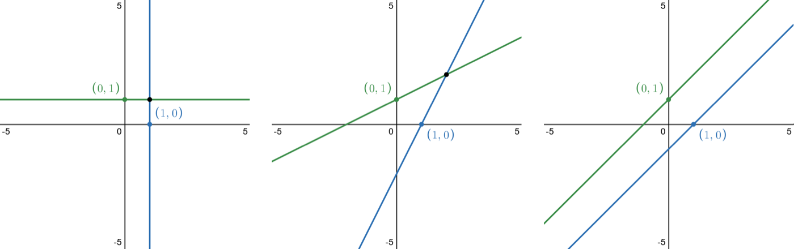
**Figure 3.** *As we drag the intersection (black point) to infinity, the lines become parallel.*

If we 'fix' the lines at \((0, 1)\) and \((1, 0)\) and 'drag' their intersection point progressively away from the origin, the lines become more and more parallel. See Figure 3. If we take the limit of this process—whatever that may mean—the lines actually become parallel, and we could make an argument that they intersect infinitely far from the origin.


This is exactly the notion that projective geometry formalizes.


The *\(n\)-dimensional projective space* \(\mathbb{P}^n\) is the set of all \((n+1)\)-tuples
\[ (x_0, \ldots, x_n) \in \mathbb{A}^{n+1} \]
such that at least one \(x_i\) is nonzero, modulo the equivalence relation
\[ (x_0, \ldots, x_n) \sim (y_0, \ldots, y_n) \]
if there exists some \(\lambda \in K^\times\) such that \(x_i = \lambda y_i\) for all \(i\).


In other words, projective \(n\)-space is the set of lines through the origin in affine \((n+1)\)-space.


The space \(\mathbb{P}^1\) looks like a circle, with antipodal points identified; likewise, \(\mathbb{P}^2\) looks like a sphere, again with antipodal points identified.


The traditional notation for points in \(\mathbb{P}^n\) is to use the \(n+1\) coordinates of the underlying space \(\mathbb{A}^{n+1}\), with the understanding that two points which can be rescaled into each other are equivalent:
\[ [10 : 15 : 45] = [2 : 3 : 9] \in \mathbb{P}^2_{\mathbb{R}}. \]
Observe that \([0 : \cdots : 0]\) is undefined, since at least one coordinate must be non-zero.

Let us now return to the study of polynomial zero-sets, but, this time, we set them in projective space. For a polynomial \(f \in K[x_0, \ldots, x_n]\) to have a well-defined zero-set in \(\mathbb{P}^n\), it must stay zero if we rescale the coordinates by \(x_i \mapsto \lambda x_i\) for any \(\lambda \in K^\times\). Observe that homogeneous polynomials satisfy this condition. We can therefore amend the definitions from the previous section to apply to projective space as follows. Since we need an additional variable for polynomials in the underlying space \(\mathbb{A}^{n+1}\), we redefine \(K[X] := K[x_0, \ldots, x_n]\).


A *projective algebraic set* is a set \(V \subseteq \mathbb{P}^n\) of the form
\[ V = \left\{ x \in \mathbb{P}^n \;\middle|\; f(x) = 0 \text{ for all } f \in I \right\}, \]
for some ideal \(I\) of homogeneous polynomials in \(K[X]\). The *ideal of \(V\)* is the set
\[ I(V) := \left\{ f \in K[X] \;\middle|\; f \text{ is homogeneous and } f(x) = 0 \text{ for all } x \in V \right\}. \]


We can define *projective varieties* entirely analogously to those in Definition 1.3. Let us now look at some examples.


Projective space greatly simplifies the intersection of lines. Consider \(K = \mathbb{R}\). (While we specified \(K\) must be algebraically closed earlier, projectivization as a concept does not require this assertion.) The parallel lines
\[ y = x, \qquad y = x + 1, \]
have no intersection in \(\mathbb{R}^2\). To convert them to projective varieties, we can *homogenize* the equations by adding a third coordinate \(z\):
\[ \begin{aligned} y - x &= 0 \\ y - x - z &= 0. \end{aligned} \]
Observe that setting \(z = 1\) returns the original set of equations. Now, solving this system of equations gives us the solution \([x : x : 0]\). Since \([0 : 0 : 0]\) is undefined, we must have \(x \neq 0\), and dividing by \(x\) yields the point \([1 : 1 : 0]\).

Geometrically, we might say the lines intersect on the *line at infinity* (\(z = 0\)) at the point reached by travelling infinitely far in the direction \((1, 1)\).



One very important takeaway is that we can interpret affine varieties as "pieces" of a larger projective variety. In particular, two affine curves that look very different may simply be distinct "affine pieces" of the same projective variety. For example, consider the following affine curves:
\[ C_1 : y^2 = x^3 - 3x, \qquad C_2 : y = x^3 - 3xy^2. \]
At first glance, the varieties defined by these equations appear completely unrelated. However, homogenizing the first equation gives us the projective curve
\[ C : y^2 z = x^3 - 3xz^2, \]
and setting \(y = 1\) returns an equation identical in form to the second one. Thus, we can say that \(C_1, C_2 \subseteq \mathbb{A}^2\) are affine pieces of a single projective variety \(C \subseteq \mathbb{P}^2\), obtained by setting \(z = 1\) and \(y = 1\) respectively. Figure 4 gives a geometric interpretation of this fact.


We call \(C\) the *projectivization* of \(C_1\) and \(C_2\). This construction is what allows us to talk about projective varieties defined by polynomial equations that are a priori not homogeneous.

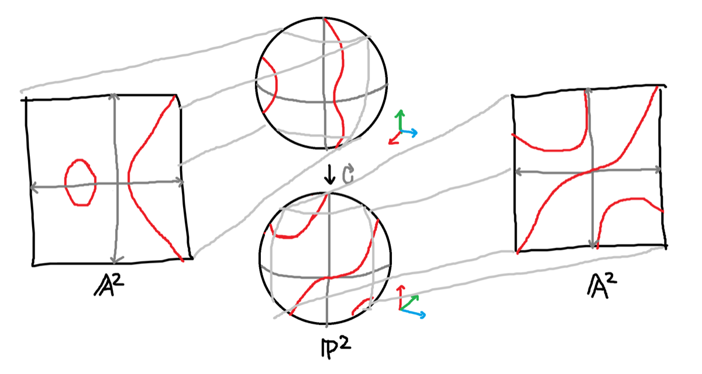
**Figure 4.** *Illustration of projective space.*

Fundamentally, the takeaway is that projective space is the natural setting for questions about algebraic curves, surfaces, and varieties.

### 1.3. Smoothness and dimension

To understand the definition of elliptic curves, we also need to talk about what "smooth" and "curve" mean. Luckily, these have more intuitive interpretations we can borrow from other fields of mathematics.

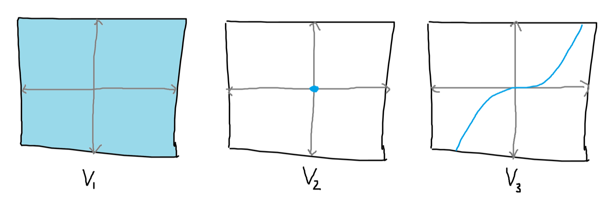
**Figure 5.** *The varieties \(V_1\), \(V_2\), and \(V_3\).*

To begin, let us discuss the terms "curve" and "surface". Consider the following three varieties:
\[ V_1 : 0 = 0, \qquad V_2 : x = y = 0, \qquad V_3 : y = x^3. \]
The first is the whole plane, the second is a single point, and the third is something geometers would traditionally call a curve. Intuitively, a curve is something that "looks" like a line, a surface is something that "looks" like a plane, and so on. More mathematically, we have a vague, intuitive, geometric notion of *dimension* to make these sorts of statements: \(V_1\) seems to be 2-dimensional, \(V_2\) seems to be 0-dimensional, and \(V_3\) seems to be 1-dimensional.

To obtain a rigorous understanding of dimension, we can look to linear algebra, where it is well defined, and adapt it for algebraic varieties. There are many ways of defining the dimension of a vector space, but the following is quite suggestive:


Let \(V\) be a vector space. The dimension of \(V\) is the largest number \(n\) such that there exists a sequence of proper subspaces \(W_i \subsetneq V\) with
\[ W_0 \subsetneq W_1 \subsetneq \cdots \subsetneq W_n \subsetneq V. \]
If there exists no such \(n\), we say \(V\) is *infinite-dimensional*.


We can immediately adapt this definition to describe varieties.


Let \(V\) be a variety. The *dimension* of \(V\), written \(\dim V\), is the largest number \(n\) such that there exists a sequence of proper subvarieties \(W_i \subsetneq V\) with
\[ W_0 \subsetneq W_1 \subsetneq \cdots \subsetneq W_n \subsetneq V. \]
Varieties with dimension one and two are called *curves* and *surfaces* respectively.


Note that because single points are themselves varieties, the only proper subvarieties of curves are points, a fact demonstrated with \(V_2\) in Figure 6.

For the rest of this article, we narrow our lens of study to just curves; fortunately, this is a small limitation since our main objects of study are elliptic curves.

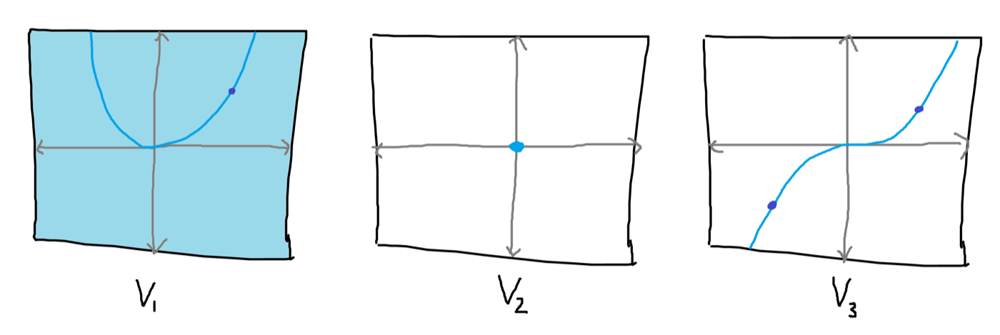
**Figure 6.** *The varieties \(V_1\), \(V_2\), and \(V_3\) again, but chains of proper subvarieties included. Note that \(V_3\) only has points for subvarieties.*

This leaves us with smoothness. Intuitively, the more you zoom in on an algebraic curve, the more it should resemble a straight line. Of course, this may not be true at all points. Consider the curves \(C_1, C_2\) given by the equations
\[ C_1 : y^2 = x^3, \qquad C_2 : y^2 = x^3 + x^2. \]
At the origin, \(C_1\) looks like a one-sided ray and \(C_2\) looks like the union of two lines. We say that \(C_1\) and \(C_2\) are *singular* or *nonsmooth* at \((0, 0)\).

The language of differential calculus allows us to formalize this concept. No limits are necessary since the power rule ensures that taking derivatives is a completely algebraic operation when working with polynomials. Looking at \(C_1, C_2\), the problem at the origin is the lack of a well-defined tangent line, so we take a closer look at tangents.

Suppose the algebraic curve \(C\) is the zero set of \(f \in K[X]\). Then, recall from differential calculus that the equation of the tangent line at some point \(P = [y_0 : \cdots : y_n]\) is given by
\[ \left.\frac{\partial f}{\partial x_0}\right|_P \cdot (x_0 - y_0) + \cdots + \left.\frac{\partial f}{\partial x_n}\right|_P \cdot (x_n - y_n) = 0. \]
This equation is well-defined if and only if none of the \(\partial f/\partial x_i|_P\) terms are zero, which motivates the following definition.


Let \(C\) be an algebraic curve given by the equation \(C : f = 0\) for some polynomial \(f \in K[X]\). We say \(C\) is *singular* at a point \(P\) if all partial derivatives \(\partial f/\partial x_i\) vanish at \(P\). If no such point exists, we say \(C\) is a *nonsingular* or *smooth* curve.


We close this section with an important theorem on the intersection numbers of algebraic curves fundamental to their study.


Suppose \(C_1, C_2\) are two projective algebraic curves given by the coprime polynomials \(f, g \in K[X]\) respectively. Then \(C_1\) and \(C_2\) intersect at
\[ \deg f \cdot \deg g \]
many points, counting multiplicities.



See [2, p. 57].


### 1.4. Genus and the Riemann-Roch theorem

Finally, let us understand what "genus one" means. Throughout this section, \(C\) denotes an algebraic curve.

As we shall see, the notion of *genus* gives us a way to classify curves based on their characteristics. To do so, we emphasize an important idea central to mathematics: *we can learn a lot about objects by studying the behavior of functions to and from them.* An apt class of functions to study in the case of algebraic curves is the polynomial and rational functions defined on it.


The *coordinate ring* \(K[C]\) is the set of polynomial functions defined on the curve \(C\). Algebraically,
\[ K[C] := \frac{K[X]}{I(C)}, \]
where recall \(I(C) \subseteq K[X]\) is the ideal of the variety \(C\). The *function field of \(C\) over \(K\)*, denoted \(K(C)\), is the field of fractions of \(K[C]\) obtained by adjoining inverses for every non-zero element of \(K[C]\). Elements of \(K(C)\) look like fractions of polynomials defined on \(C\).


If the rational function \(f\) is undefined at some point \(x\), we say it has a *pole* and write \(f(x) = \infty\).


Let \(C\) be the projective curve in \(\mathbb{R}^2\) given by the equation \(y^2 = x^3 + x + 1\). Consider the rational functions \(f, g, h \in \mathbb{R}(x, y)\) given by
\[ f = x, \qquad g = \frac{x^3 + x + 1}{xy^2}, \qquad h = \frac{1}{x}, \]
with \((x, y) \in C\). Making the substitution \(y^2 = x^3 + x + 1\), we see \(f \neq g = h\) when considered as elements of \(\mathbb{R}(C)\). Additionally, the function \(f\) has zeros of multiplicity one at \([0:1:1]\) and \([0:-1:1]\) and a pole of multiplicity two at \([0:1:0]\). Likewise, \(g\) has poles of multiplicity one at \([0:1:1]\) and \([0:-1:1]\) and a zero of multiplicity two at \([0:1:0]\).


Looking at these functions, the important information contained in each one is whether it has a zero or a pole at a certain point on the curve and the multiplicities of each. That is, we care about the *order* of the rational function.


Let \(C\) be an algebraic curve. The *order* of a function \(f \in K(C)\) at a point \(x \in C\) is defined by
\[ \operatorname{ord}_x(f) = \begin{cases} \text{multiplicity of zero at } x & \text{if } f(x) = 0, \\ -(\text{multiplicity of pole at } x) & \text{if } f(x) = \infty, \\ 0 & \text{otherwise.} \end{cases} \]



For the rational functions \(f, g\) from Example 1.15, we have
\[ \begin{aligned} \operatorname{ord}_{[0:\pm 1:1]}(f) &= -\operatorname{ord}_{[0:\pm 1:1]}(g) = 1, \\ \operatorname{ord}_{[0:1:0]}(f) &= -\operatorname{ord}_{[0:1:0]}(g) = -2. \end{aligned} \]


One way to keep track of these data is by using *Weil divisors*, which are elements of the free abelian group \(\operatorname{Div}(V)\) generated by codimension one subvarieties. Recall that for curves the only proper subvarieties are points, so divisors are merely formal sums of points on the curve. That is, they are formal sums of the form
\[ \sum_{x \in C} n_x \cdot [x], \]
with only finitely many non-zero \(n_x\). There are a few important categories, classifications, and results regarding divisors necessary for the study of elliptic curves.


A *principal divisor* is a divisor that can be written in the form
\[ \operatorname{div}(f) := \sum_{x \in C} \operatorname{ord}_x(f) \cdot [x], \]
for some nonzero rational function \(f \in K(C)\). This is well-defined, since rational functions have only finitely many zeros or poles [6, p. 148].



The *degree* \(\deg D\) of a divisor \(D\) is the sum of its coefficients.



Let \(C\) and \(f, g\) be as in Example 1.15. Then, we have
\[ \begin{aligned} \operatorname{div}(f) &= [0 : 1 : 1] + [0 : -1 : 1] - 2[0 : 1 : 0], \\ \operatorname{div}(g) &= 2[0 : 1 : 0] - [0 : 1 : 1] - [0 : -1 : 1]. \end{aligned} \]
For both \(f\) and \(g\), the corresponding principal divisors both have degree zero. This is a general fact, as shown in Proposition 1.21.



The principal divisors form a subgroup of the set
\[ \operatorname{Div}^0(C) := \{ D \in \operatorname{Div}(C) \mid \deg D = 0 \} \]
which is itself a subgroup of \(\operatorname{Div}(C)\).



Observe by definition that
\[ \operatorname{div}(fg) = \operatorname{div}(f) + \operatorname{div}(g), \qquad \text{and} \qquad \operatorname{div}(1/f) = -\operatorname{div}(f), \]
so the principal divisors are a group. To see that they are a subgroup of \(\operatorname{Div}^0(C)\), see [4, p. 138] or [6, p. 163].



An important class of divisors associated to each curve \(C\) are the *canonical divisors* on \(C\). All canonical divisors \(K_C\) are linearly equivalent, so we often refer to "the" canonical divisor of a curve. A proper treatment of these objects is outside the scope of this article; see [1, pp. 30–33].

Intuitively, canonical divisors capture aspects of the differential structure—such as curvature—of algebraic curves. Regardless, for the purposes of studying elliptic curves, we may sidestep canonical divisors entirely by way of Corollary 1.24.


With all this infrastructure, we can begin to classify rational functions on elliptic curves. Geometers studying curves (and other varieties) are curious about what sorts of rational functions are possible when prescribing a certain set of zeros and poles with multiplicities. More specifically, letting \(D\) be some divisor on the curve \(C\), we can ask: *what functions have no more poles than specified by \(D\)?*

The celebrated Riemann-Roch theorem gives us a very precise estimate on the dimension of \(\mathcal{L}(D)\), the vector space of such functions on \(C\), in terms of a special invariant of \(C\) which we term the *genus*.


Let \(C\) be a smooth curve and let \(K_C\) be a canonical divisor on \(C\). Then, there exists an integer \(g \geq 0\), called the *genus* of \(C\), such that for every divisor \(D \in \operatorname{Div}(C)\),
\[ \dim \mathcal{L}(D) - \dim \mathcal{L}(K_C - D) = \deg D - g + 1. \]



See [4, p. 431] or [7, p. 5].


The Riemann-Roch theorem is one of the most important tools in the algebraic geometer's toolkit. For our use, we show three straightforward corollaries:


Let \(D\) be a divisor on \(C\) and denote \(\dim \mathcal{L}(D)\) by \(\ell(D)\). Then

- (a) \(\ell(K_C) = g\).
- (b) \(\deg K_C = 2g - 2\).
- (c) If \(\deg D > 2g - 2\), then \(\ell(D) = \deg D - g + 1\).



(a) Set \(D = 0\). Then, we have
\[ \ell(0) - \ell(K_C) = 0 - g + 1, \]
by Riemann-Roch. Only the constant functions \(f \in K^\times\) can have a divisor equal to zero, so \(\ell(0) = 1\). Thus, we have \(\ell(K_C) = g\).

(b) Now set \(D = K_C\). Then, we have
\[ \ell(K_C) - \ell(0) = \deg K_C - g + 1, \]
so using the results of (a), we obtain \(\deg K_C = 2g - 2\).

(c) Since \(\deg D > 2g - 2\), we know \(\deg(K_C - D) < 0\). Thus, \(\ell(K_C - D) = 0\), so Riemann-Roch tells us \(\ell(D) = \deg D - g + 1\).


When our elliptic curves are defined over the complex numbers \(\mathbb{C}\), the algebraic genus yielded by the Riemann-Roch theorem corresponds exactly to the standard, topological notion of genus—the number of "holes" in a surface. Since elliptic curves are genus one, as we shall soon see, we can also view them as complex tori! For a close look at this connection, see [1, §VI].

**Figure 7.** *Elliptic curves as complex tori.*

### 1.5. The real definition of elliptic curves

With all this machinery, we finally arrive at a new definition of elliptic curves, one which emphasizes their unique geometric qualities.


An *elliptic curve* is a pair \((E, O)\), where \(E\) is a smooth, projective, algebraic curve of genus one and \(O \in E\) is a specified point.


As a stepping stone to obtaining the form for elliptic curves specified in Definition 0.1, we can write them as a *Weierstrass equation*. I give only a sketch of the proof; for a fully rigorous treatment of the subject, see Silverman [1, p. 59].


Let \(E\) be an elliptic curve defined over \(K\). There exist functions \(f, g \in K(E)\) such that the map \(\phi : E \to \mathbb{P}^2\) defined by
\[ \phi(P) = [f(P) : g(P) : 1], \]
yields an isomorphism of \(E\) onto a curve given by a Weierstrass equation
\[ C : y^2 + a_1 xy + a_3 y = x^3 + a_2 x^2 + a_4 x + a_6 \]
with coefficients \(a_1, \ldots, a_6 \in K\) and satisfying \(\phi(O) = [0 : 1 : 0]\).



Since \(E\) is an elliptic curve (as defined above), it has some specified base point \(O \in E\). When representing elliptic curves, we represent the base point using a single, specific point at infinity. Thus, our desired \(f\) and \(g\) ought to have a pole at \(O\) (meaning they go to infinity at \(O\)). Let's therefore look at the space of functions \(\mathcal{L}(n \cdot O)\) for \(n \geq 1\). Since
\[ \deg(n \cdot O) = n > 2g - 2 = 0, \]
where we used the fact that elliptic curves have genus one, Corollary 1.24 yields us
\[ \dim \mathcal{L}(n \cdot O) = n. \]
Thus, since \(\mathcal{L}(2 \cdot O)\) by definition is a subspace of \(\mathcal{L}(3 \cdot O)\), we can find functions \(s, t \in K(E)\) such that \(1, s\) are a basis for \(\mathcal{L}(2 \cdot O)\), and \(1, s, t\) form a basis for \(\mathcal{L}(3 \cdot O)\). Necessarily, this means \(s\) has a pole of order two at \(O\), while \(t\) has a pole of order three. Therefore, the seven functions
\[ 1, \; s, \; t, \; s^2, \; st, \; t^2, \; s^3, \]
which have poles of order 0, 2, 3, 4, 5, 6, 6 respectively at \(O\), are members of \(\mathcal{L}(6 \cdot O)\). But this space has dimension six, so they must be linearly dependent! Thus there exist coefficients \(A_1, \ldots, A_7\), not all zero, satisfying
\[ A_1 + A_2 s + A_3 t + A_4 s^2 + A_5 st + A_6 t^2 + A_7 s^3 = 0. \]
Additionally, we know both \(A_6\) and \(A_7\) must be non-zero, since they are the only two terms with the same order at \(O\). Otherwise all the \(A_i\) would have to be zero. To recover a Weierstrass equation, we only need to substitute \(s = -A_6 A_7 x\) and \(t = A_6 A_7^2 y\) and divide by \(A_6^3 A_7^4\). Try it out!

We have a nice set of coordinate functions \(x, y \in K(E)\) now. It remains to show they induce an isomorphism \(\phi : E \to C \subseteq \mathbb{P}^2\). To do this, we need the tools of more advanced algebraic geometry, which is outside of the scope of this article.


Finally, suppose \(K\) has characteristic not equal to 2 or 3, and let \(C\) be the curve from Theorem 1.26. We can make certain substitutions to obtain a simpler equation for the curve. Define the constants
\[ b_2 = a_1^2 + 4a_4, \qquad b_4 = 2a_4 + a_1 a_3, \qquad b_6 = a_3^2 + 4a_6, \]
and further define
\[ c_4 = b_2^2 - 24 b_4, \qquad c_6 = -b_2^3 + 36 b_2 b_4 - 216 b_6. \]
Then, writing the Weierstrass equation for \(C\) in terms of the \(c_i\) and changing coordinates with the substitution
\[ (x, y) \mapsto \left( \frac{x - 3b_2}{36}, \frac{y}{108} \right), \]
we obtain the equation
\[ C : y^2 = x^3 - 27 c_4 x - 54 c_6, \]
which is precisely the form of the equation described in Definition 0.1! The strange condition \(4a^3 + 27b^2 \neq 0\) is a consequence of the nonsingularity of elliptic curves (see [1, p. 45]) and a short calculation will demonstrate that \(a = -27c_4\) and \(b = -54c_6\) satisfy this constraint.

## 2. Elliptic curves are groups

We know now that elliptic curves can be neatly defined as projective curves satisfying certain important properties: they are smooth, have genus one, and have a certain special point marked out. While this characterization allows us to distinguish the seemingly random equation \(y^2 = x^3 + ax + b\) from other polynomial equations, it may not clarify why these objects are worth studying in and of themselves. To address this point, we discuss a second answer to the question of what makes elliptic curves special — that they are abelian groups. That is, if \(E\) is an elliptic curve, we can define a binary operation \(\oplus\) on \(E\) in some natural, meaningful way to turn \(E\) into a non-trivial abelian group.

In this section, we first look at a geometric construction of this *group law* and then consider an equivalent, purely algebraic characterization. After this, we take a whirlwind tour of the group's unique properties. Lastly, we demonstrate the real-world importance of the group structure by investigating its use in elliptic-curve cryptography.

### 2.1. The geometric group law

Let \(E\) be an elliptic curve over \(K\), with base point \(O\). Further suppose \(E\) is given by a Weierstrass equation. We can define the *geometric group law* on \(E\) by the following procedure. Let \(P, Q \in E\).

1. If \(P \neq Q\), let \(L\) be the unique line passing through both points. Otherwise, let \(L\) be the line tangent to \(E\) at \(P\), which exists because \(E\) is nonsingular.
2. Since \(E\) is given by a degree-three equation and \(L\) has degree one, Bezout's theorem tells us \(L \cap E\) must contain, with multiplicity, exactly three points: \(P\), \(Q\), and a third point, which we denote \(R\).
3. Now, draw a line \(L'\) through \(O\) and \(R\). Again by Bezout's theorem, \(L' \cap E\) must contain \(O\), \(R\), and a third point \(R'\). Define \(P \oplus Q\) to be \(R'\).

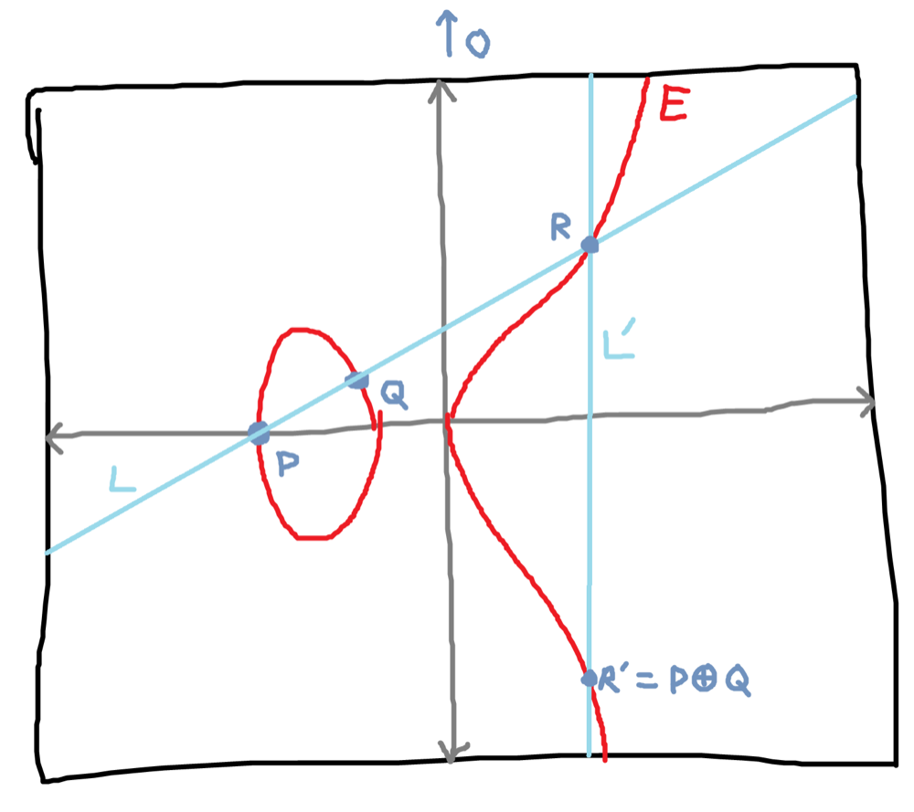
**Figure 8.** *The geometric group law, illustrated.*

With the operation \(\oplus\) so defined, it remains to show it makes \(E\) an abelian group.


The elliptic curve \(E\), with the operation \(\oplus\) as defined above, is an abelian group with identity \(O\). Specifically, \(\oplus\)

- (a) is associative: for all \(P, Q, R \in E\), \(\;P \oplus (Q \oplus R) = (P \oplus Q) \oplus R\).
- (b) has an identity: for all \(P \in E\), \(\;P \oplus O = O \oplus P = P\).
- (c) is invertible: for all \(P \in E\), there exists a point \(Q \in E\) such that \(P \oplus Q = Q \oplus P = O\).
- (d) is commutative: for all \(P, Q \in E\), \(\;P \oplus Q = Q \oplus P\).



Unsurprisingly, showing part (a)—that \(\oplus\) is associative—requires the most effort, so we will cover it separately. The remaining three requirements essentially follow directly from the definition of the group law and are also easily seen by diagramming the Weierstrass equation, as seen in Figure 8.

For parts (b) and (c), by following the procedure, the line \(L\) through \(O\) and \(P\) produces a point \(R\). Now, the line \(L'\) through \(O\) and \(R\) must be the same as \(L\), so \(P \oplus O = P\). The middle equality follows from commutativity. Additionally, note that \(R\) is the inverse of \(P\).

Finally, of the three, part (d)—commutativity—is the simplest. Since \(P\) and \(Q\) both define the same line \(L\), the group law procedure makes no distinction between \(P \oplus Q\) and \(Q \oplus P\). Thus, they must be equal.



As an aside, we have just shown that \((E, \oplus)\) is a commutative loop, and it can therefore be shown that every point \(P\) in \(E\) has a unique inverse, which we denote \(\ominus P\). Thus, following the definition of the group law, for two points \(P, Q \in E\), the point \(\ominus(P \oplus Q)\) is the third point in \(L \cap E\), where \(L\) is the line through \(P\) and \(Q\).


Let us now prove associativity. The following is an elegant, partial proof adapted from Milne. The only additional result we need is a classic theorem on cubics.


Suppose two cubic curves \(C_1, C_2 \subseteq \mathbb{P}^2\) intersect in nine distinct points. Then, any cubic that passes through eight of these points must pass through the ninth.



See [8, p. 27] or [9, p. 29].


We are now ready to complete our proof of Theorem 2.1 in a certain, elegant special case. For a complete proof, see [8, p. 29] or [2, p. 63].


In this proof, \(\ell(A, B)\) refers to the polynomial for the unique line \(L(A, B) \subseteq \mathbb{P}^2\) containing the points \(A\) and \(B\). With that, let \(P, Q, R\) be distinct points on \(E\). Then, by definition, \(\ominus(Q \oplus R)\) is collinear with \(Q\) and \(R\), while \(\ominus(P \oplus Q)\) is collinear with \(P\) and \(Q\), as shown in Figure 9(a). If we include the point \(O\), we get a set of eight points by noting \(Q \oplus R\) is collinear with \(O\) and \(\ominus(Q \oplus R)\); and likewise for \(P \oplus Q\) with \(O\) and \(\ominus(P \oplus Q)\). This is illustrated in Figure 9(b).

Now, consider the following two cubic curves:
\[ C_1 : \ell(Q, R) \cdot \ell(P, Q \oplus R) \cdot \ell(Q \oplus R, O) = 0, \]
and
\[ C_2 : \ell(P, Q) \cdot \ell(P \oplus Q, R) \cdot \ell(P \oplus Q, O) = 0. \]
Looking at the diagram, both \(C_1\) and \(C_2\) pass through the eight points
\[ P, \quad Q, \quad R, \quad O, \quad P \oplus Q, \quad Q \oplus R, \quad \ominus(P \oplus Q), \quad \ominus(Q \oplus R), \]
as does \(E\), by definition of \(\oplus\). Additionally, the curves \(C_1\) and \(C_2\) must pass through a ninth point
\[ S = L(P, Q \oplus R) \cap L(P \oplus Q, R), \]
as shown in Figure 9(c).

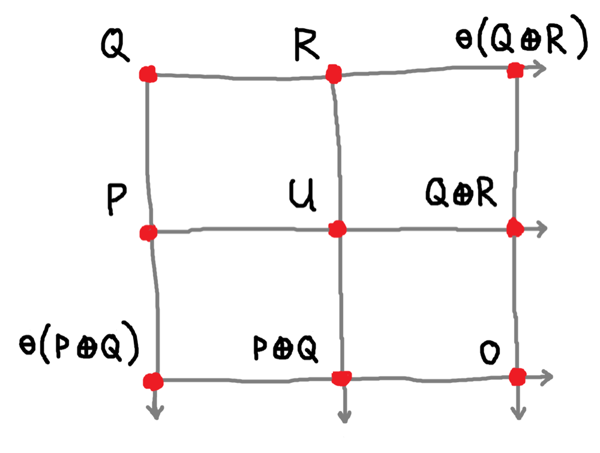
**Figure 9.** *The relevant points and lines for the proof of associativity of the geometric group law.*

Thus, if the nine points are distinct, we can apply Theorem 2.3 to \(E\), which goes through eight of them—so we know \(S \in E\). Now, observe \(S\) is the third point in \(E \cap L(P, Q \oplus R)\), so we know
\[ S = \ominus(P \oplus (Q \oplus R)). \]
Likewise, \(S\) is the third point in \(E \cap L(P \oplus Q, R)\), so we also have
\[ S = \ominus((P \oplus Q) \oplus R). \]
Therefore, we obtain
\[ P \oplus (Q \oplus R) = \ominus S = (P \oplus Q) \oplus R, \]
as desired.


### 2.2. The algebraic group law

We gave a geometric description of the group law on elliptic curves in the previous section. Now we consider the algebraic perspective. Using Riemann-Roch, we can derive the same group structure using purely algebraic means.

To begin, we need to revisit the concept of divisors. In §1.4, I said that divisors provide a way of categorizing function data, but, in truth, this is only a small piece of what makes them so useful. In fact, carefully studying divisors on elliptic curves is exactly the method by which we can obtain the group law algebraically.


Let \(C\) be a smooth curve. Two divisors \(D_1, D_2 \in \operatorname{Div}(C)\) are said to be *linearly equivalent* if there exists some function \(f \in K(C)^\times\) such that
\[ D_2 - D_1 = \operatorname{div}(f). \]
That is, their difference is a principal divisor. We denote this by \(D_1 \sim D_2\).



Recall that
\[ \operatorname{div} : K(C) \to \operatorname{Div}^0(C) \]
is a group homomorphism, meaning for \(f, g \in K(C)\), we have
\[ \operatorname{div}(fg) = \operatorname{div}(f) + \operatorname{div}(g). \]
Thus, linear equivalence captures the behavior of rational functions up to multiplication by some other rational function.



The *Picard group* or *divisor class group* \(\operatorname{Pic}(C)\) is the quotient group of \(\operatorname{Div}(C)\) by the subgroup of principal divisors.


We further denote the quotient group \(\operatorname{Div}^0(C)/\sim\) by \(\operatorname{Pic}^0(C)\). With these definitions in hand, we now closely follow the algebraic derivation of the group law given in [1, pp. 61–63]. The first step is establishing the equivalence between "singleton" divisors and points on the curve \(C\).


Let \(C\) be a curve with genus one. Let \(P, Q \in C\). Then, \([P] \sim [Q]\) if and only if \(P = Q\).



The reverse implication is straightforward since \(\sim\) is an equivalence relation and is therefore reflexive. Conversely, suppose \([P] \sim [Q]\). By the definition of linear equivalence, there exists some \(f \in K(C)^\times\) such that
\[ \operatorname{div}(f) = [P] - [Q]. \]
This means \(\operatorname{div}(f) \geq -[Q]\), so \(f \in \mathcal{L}([Q])\). Since \(C\) has genus one, we know by the Riemann-Roch theorem—specifically Corollary 1.24—that \(\dim \mathcal{L}([Q]) = 1\). Thus, \(f \in K\), since \(\mathcal{L}([Q])\) contains \(K\) itself. But then, \(\operatorname{div}(f) = 0\), meaning
\[ 0 = [P] - [Q]. \]
This can only be true if \(P = Q\).



Let \(E\) be an elliptic curve.

- (a) For every \(D \in \operatorname{Div}^0(E)\), there exists a unique point \(P \in E\) such that \(D \sim [P] - [O]\).
- (b) Let \(\phi : \operatorname{Div}^0(E) \to E\) be the map sending the divisor \(D\) to the associated point \(P\) on \(E\). Then, \(\phi\) is surjective.
- (c) Let \(D_1, D_2 \in \operatorname{Div}^0(E)\). Then, \(\phi(D_1) = \phi(D_2)\) if and only if \(D_1 \sim D_2\), so we have an induced bijection \(\tilde\phi : \operatorname{Pic}^0(E) \to E\).



(a) We first show such a point exists. Since \(E\) is genus one, we have
\[ \dim \mathcal{L}(D + [O]) = 1, \]
so let \(f\) be a basis for \(\mathcal{L}(D + [O])\). By definition, \(f\) satisfies
\[ \operatorname{div}(f) \geq -D - [O]. \]
Additionally, \(\deg(\operatorname{div}(f)) = 0\). Thus, there exists some point \(P \in E\) such that
\[ \operatorname{div}(f) = -D - [O] + [P]. \]
Therefore, \(D \sim [P] - [O]\) as desired. Now, we need to show \(P\) is unique, so further suppose \(D \sim [P'] - [O]\) for some point \(P' \in E\). Then, we have
\[ [P] - [O] \sim D \sim [P'] - [O]. \]
Adding \([O]\) to the leftmost and rightmost sides gives us \([P] \sim [P']\), which, by Lemma 2.7, means \(P = P'\). Therefore, \(P\) is unique.

(b) Let \(P \in E\). Observe
\[ \phi([P] - [O]) = P, \]
so \(\phi\) is surjective.

(c) Suppose \(\phi(D_1) = \phi(D_2)\). Then, by definition of \(\phi\),
\[ D_1 \sim [\phi(D_1)] - [O] = [\phi(D_2)] - [O] \sim D_2, \]
as desired. Conversely, suppose \(D_1 \sim D_2\). Then, we have
\[ D_1 \sim [\phi(D_1)] - [O] \qquad \text{and} \qquad D_1 \sim D_2 \sim [\phi(D_2)] - [O]. \]
From part (a), the point \(P\) satisfying
\[ D_1 \sim [P] - [O] \]
is unique, so we have \(\phi(D_1) = \phi(D_2)\).


Denote the inverse \(\tilde\phi^{-1} : E \to \operatorname{Pic}^0(E)\) by \(\varphi\). The proof of part (b) demonstrates that \(\varphi\) sends each point \(P \in E\) to the divisor class (the equivalence class in \(\operatorname{Pic}^0\)) of \([P] - [O]\). With this information, we can now impose a group structure on \(E\) by forcing the bijection \(\tilde\phi\) to be a group isomorphism between \(\operatorname{Pic}^0(E)\) and \(E\). That is, define the binary operation \(\oplus\) on \(E\) by
\[ P \oplus Q = \tilde\phi\big(\tilde\phi^{-1}(P) + \tilde\phi^{-1}(Q)\big). \]
Crucially, this group law corresponds exactly to the geometric group law described in §2.1, as we shall now prove.


Suppose \(E \subseteq \mathbb{P}^2\) is given by a Weierstrass equation. Then, the geometric group law described in §2.1 is equivalent to the algebraic group law induced on \(E\) by forcing \(\tilde\phi : \operatorname{Pic}^0(E) \to E\) to be a group homomorphism.



It suffices to show that \(\varphi\) is a group homomorphism by showing
\[ 0 \sim \varphi(P \oplus Q) - \varphi(P) - \varphi(Q), \]
where \(\oplus\) is the geometric group operation described in §2.1. To that end, let \(P, Q \in E\). Let \(L\) be the line passing through \(P\) and \(Q\), given by the equation
\[ f(x, y, z) = 0. \]
Let \(R\) be the third point in \(L \cap E\) and let \(L'\) be the line passing through \(O\) and \(R\), given by the equation
\[ f'(x, y, z) = 0. \]
Then, by the definition of the geometric group law, \(P \oplus Q\) must be the third point in \(L' \cap E\). Because \(E\) is a degree 3 curve, the intersection of \(E\) with the line given by \(z = 0\) must be of multiplicity three, meaning \(z \in K(E)\) has a zero of order three at \(O\). Therefore,
\[ \begin{aligned} \operatorname{div}(f/z) &= \operatorname{div}(f) - \operatorname{div}(z) \\ &= [P] + [Q] + [R] - 3[O]. \end{aligned} \]
Likewise,
\[ \begin{aligned} \operatorname{div}(f'/z) &= \operatorname{div}(f') - \operatorname{div}(z) \\ &= [P \oplus Q] + [R] - 2[O]. \end{aligned} \]
Combining these two results gives us
\[ \begin{aligned} 0 \sim \operatorname{div}(f'/f) &= \operatorname{div}(f') - \operatorname{div}(f) \\ &= [P \oplus Q] - [P] - [Q] + [O] \\ &\sim \varphi(P \oplus Q) - \varphi(P) - \varphi(Q), \end{aligned} \]
as desired.


### 2.3. Properties of the elliptic curve group

We have now spent a considerable effort on demonstrating that elliptic curves possess a certain group structure. A natural question to ask is why these groups are special. That is, are they worth studying in their own right?

This section and the next attempt to answer this question. Specifically, in this section, I give a variety of major or otherwise interesting results characterizing the group structure of an elliptic curve; many of these findings are the result of decades of intense study of the groups in question. Unfortunately, their proofs are far out of the scope of this article, but I have provided references for standard proofs of each. Lastly, for the purpose of exposition, we only consider elliptic curves over the rational numbers \(\mathbb{Q}\).

We recall the fundamental theorem of finitely generated abelian groups:


Let \(G\) be a finitely generated abelian group. We can write
\[ G \cong G_{\text{tors}} \oplus \mathbb{Z}^n, \]
where \(G_{\text{tors}}\) is the *torsion subgroup* of \(G\) consisting of those points with finite order and \(n \geq 0\) is called the *rank* of \(G\).



See [10, p. 196].


With that, let \(E\) be an elliptic curve over \(\mathbb{Q}\). Much work has gone into describing the group \(E(\mathbb{Q})\) of \(\mathbb{Q}\)-rational points on \(E\), known as the *Mordell-Weil group* of \(E\). The first major step is the Mordell theorem.


The group \(E(\mathbb{Q})\) is finitely generated.



See [11] or [12].


Now, we immediately apply Theorem 2.10 to decompose \(E(\mathbb{Q})\) into its torsion and torsion-free parts.


We have
\[ E(\mathbb{Q}) \cong E(\mathbb{Q})_{\text{tors}} \oplus \mathbb{Z}^r \]
for some \(r \geq 0\). The quantity \(r\) is called the *rank* of the elliptic curve \(E\).


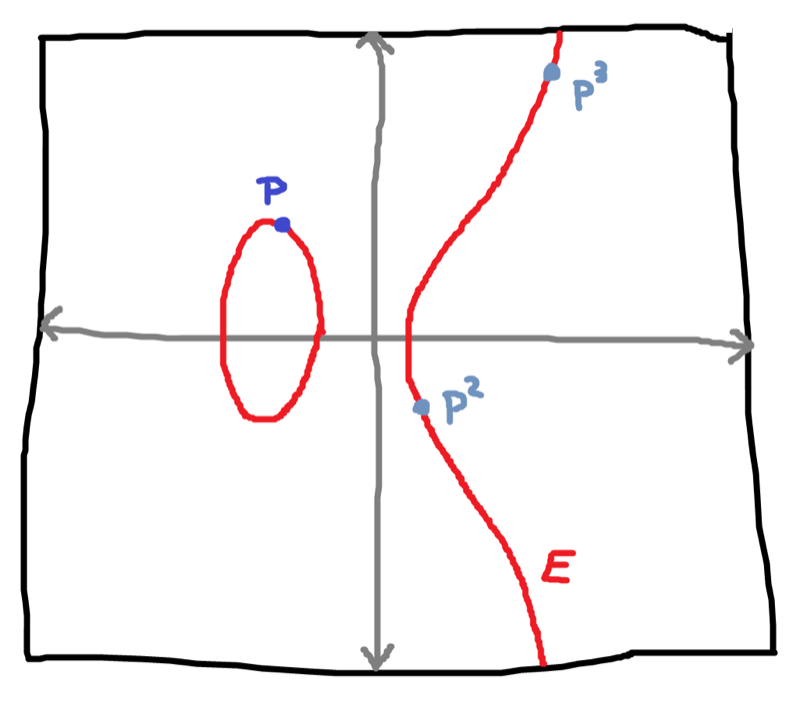
**Figure 10.** *An elliptic curve \(E\), and the powers of a point \(P \in E\).*

Continuing on, Corollary 2.12 gives us two avenues for characterizing \(E(\mathbb{Q})\): its torsion and its rank. Of the two, arithmetic geometers have characterized the torsion subgroup \(E(\mathbb{Q})_{\text{tors}}\) to a much greater degree. Two important results in this direction are a theorem of Nagell and Lutz and a theorem of Mazur. The latter of these greatly limits the possibilities for \(E(\mathbb{Q})_{\text{tors}}\).


Suppose \(E\) has the Weierstrass equation
\[ y^2 = x^3 + ax + b, \]
for integer \(a, b\). Then, for all torsion points \(P = (x, y) \in E\):

- (a) The coordinates \(x, y\) are integer-valued; in other words, \(P\) is \(\mathbb{Z}\)-rational.
- (b) If the order of \(P\) in \(E(\mathbb{Q})\) is 2, then \(y = 0\).
- (c) Otherwise, if \(P\) has order \(> 2\), then \(y^2\) must divide \(4a^3 + 27b^2\).



Of the three parts, (b) can be easily seen with the geometric group law. For \(P\) to have order 2, then \(P \oplus P = O\). For this to be the case, the line \(L\) passing through \(P\) and \(O\) cannot pass through any other points. Since \(L\) is vertical and \(E\) is symmetric across the \(x\)-axis, \(P\) can only be on the \(x\)-axis. Thus, \(y = 0\).

For the other two, see [14, p. 56].



The only possible torsion subgroups \(E(\mathbb{Q})_{\text{tors}}\) are:

- (a) \(\mathbb{Z}/n\mathbb{Z}\), with \(2 \leq n \leq 10\) or \(n = 12\), or
- (b) \(\mathbb{Z}/2\mathbb{Z} \oplus \mathbb{Z}/2n\mathbb{Z}\), with \(0 < n < 5\).



For nice exposition, see [15]. Mazur's original proof is in [16].


Characterizing the rank of elliptic curves remains a much greater challenge to this day. Silverman describes the following "folklore conjecture":


There exist elliptic curves \(E\) defined over \(\mathbb{Q}\) of arbitrarily large rank.


Little progress has been made on this front. On the one hand, the work of Shafarevich and Tate [13] shows the conjecture holds for elliptic curves over function fields \(\mathbb{F}_p(T)\) instead of \(\mathbb{Q}\), a fact Silverman describes as "key evidence" for Conjecture 2.15. On the other hand, recent heuristics suggest elliptic curve ranks may be bounded—to the point that there may only be finitely many curves of rank \(\geq 21\) [3]. In the meantime, the highest known lower bound on the rank of a curve is 29 [17].

Finally, a discussion of the rank of \(E(\mathbb{Q})\) would be incomplete without mentioning the famous conjecture of Birch and Swinnerton-Dyer, one of the seven Millennium Prize Problems. While the problem statement in the form given by Wiles is far out of reach of this article, the path to the full conjecture started with a simpler one, which we give here.

Define the function
\[ f_E(n) = \prod_{p \leq n} \frac{N_p}{p}, \]
where the product runs over all primes \(p \leq n\), and \(N_p\) is the number of points of \(E\) that are rational over the field with \(p\) elements \(\mathbb{F}_p\). Then, the conjecture is:


Let \(r\) be the rank of \(E\). Then \(f_E(n) \sim C(\log n)^r\) as \(n \to \infty\). In other words,
\[ \lim_{n \to \infty} \frac{f_E(n)}{C(\log n)^r} = 1. \]


A proper exposition on this conjecture is far, far beyond the scope of this article. Regardless, the upshot is that studying the Mordell-Weil group is a lively, active area of pure mathematical research, attracting some of the top minds in the field.

### 2.4. Elliptic-curve cryptography

If the goal of the previous section was to show the importance of the group structure on elliptic curves in pure mathematics, this one seeks to demonstrate the role it plays in public-key cryptography, an applied field of great significance. As many of the specifics are unimportant to showing the importance of elliptic curves, I have kept this section less detailed. Chapter XII of Silverman [1, p. 363] provides an excellent, more thorough exposition on elliptic-curve cryptography. Beyond that, [18] covers the subject in more detail.

The basic setup for our problem is as follows: two individuals, Alice and Bob, are communicating sensitive information over a channel. Unfortunately, also on the channel is an eavesdropper, Eve, from whom Alice and Bob would like to keep their information private. The simplest approach is *symmetric-key cryptography*, where both Alice and Bob share a secret piece of information called a *key*. Then, Alice can send a message to Bob in the following way.


Let \(\mathcal{M}\) be the space of messages and let \(K\) be a key. Let \(f_K : \mathcal{M} \to \mathcal{M}\) be injective. The following procedure allows Alice to securely send a message to Bob.

1. Alice encrypts her plaintext \(m \in \mathcal{M}\) to produce a ciphertext \(c = f_K(m)\).
2. Alice sends the ciphertext \(c\) over the insecure channel. Since Eve does not have the key \(K\), she is unable to decrypt the message.
3. Bob decrypts the ciphertext to receive the plaintext \(m = f_K^{-1}(c)\).


While secure, this procedure relies on a secret key shared between Alice and Bob, which they would have to have agreed upon earlier. This poses a problem for secure communication between people who have never met. Luckily, the group nature of elliptic curves allows the generation of a shared secret, through a procedure known as *Diffie-Hellman key exchange* (ECDH).


Let \(E\) be an elliptic curve and let \(n \in \mathbb{N}\). We denote repeated addition of a point \(P \in E\) by
\[ [n]P = \underbrace{P \oplus \cdots \oplus P}_{n \text{ times}}. \]



Let \(\mathbb{F}_p\) be a finite field, \(E\) be an elliptic curve over \(\mathbb{F}_p\), and \(P \in E(\mathbb{F}_p)\) be a specified point. The following procedure allows Alice and Bob to securely generate a shared secret key.

1. Alice selects a secret integer \(a\) and computes the point \(A = [a]P\).
2. Bob selects a secret integer \(b\) and computes the point \(B = [b]P\).
3. Alice and Bob exchange the points \(A\) and \(B\) over the insecure channel.
4. Using their respective secret integers, Alice and Bob compute the point \[ [ab]P = [a]B = [b]A, \] which is their shared secret.


Once the shared key is generated, Alice and Bob can rely on Algorithm 2.17 for further secure communication. Meanwhile, Eve knows the values of the points \([a]P\), \([b]P\), and \(P\), but not \([ab]P\), the point she needs to decrypt messages. The problem of deducing \([ab]P\) from the other three points is known as the *elliptic curve Diffie-Hellman problem*. At present, the only way to do so is by knowing the value of \(a\) or \(b\) [1, p. 378]; this problem of finding \(a\) from the equation \(A = [a]P\) is known as the *elliptic curve discrete logarithm problem*.


The points \(A\) and \(B\) are known as *public keys*, and Diffie-Hellman key exchange falls into the realm of *public-key cryptography*. The security of this approach depends on *one-way functions*, which are injective functions that are computationally easy to evaluate, but difficult to invert. The assumption that the function \(f : \mathbb{Z} \to E(\mathbb{F}_p)\) defined by
\[ f(x) = [x]P, \]
for some point \(P \in E(\mathbb{F}_p)\), is one-way is central to Diffie-Hellman key exchange, and other forms of public-key cryptography relying on the discrete logarithm problem.



Astute readers may note that nothing in Algorithm 2.19 depends on the specific nature of the elliptic curve group \(E(\mathbb{F}_p)\). Indeed, one could instead use the groups \(\mathbb{F}_p\) or \(\mathbb{F}_p^\times\) instead. The advantage of using elliptic curves is that the discrete logarithm problem is much more difficult to solve than with those other groups, meaning the size of \(p\) can be a great deal smaller [1, p. 376].


Elliptic-curve Diffie-Hellman key exchange is but one of a whole suite of cryptographic protocols exploiting the properties of certain elliptic curves. Others include the elliptic-curve Massey-Omura and ElGamal cryptosystems, which allow users to securely transmit information [19]; and the Elliptic Curve Digital Signature Algorithm, which enables users to electronically sign documents and messages [20]. These algorithms are all widely used in modern communications, especially over the Internet. The following example demonstrates an elliptic-curve Diffie-Hellman key exchange used to securely communicate with the server hosting the website of the U. of C. mathematics department.


One can visit the University of Chicago Mathematics website at <https://mathematics.uchicago.edu>. The 's' in "https" stands for "secure," and indicates the communication channel will be encrypted using the Transport Layer Security (TLS) protocol. In our case, this means conducting a Diffie-Hellman key exchange to generate a key in order to encrypt the website data during transmission. We can use a software utility to inspect the information exchanged between the client and the server.

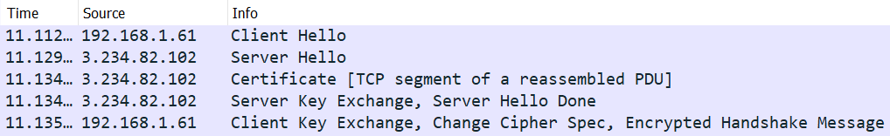
*(a) Exchanged packets between server and client.*

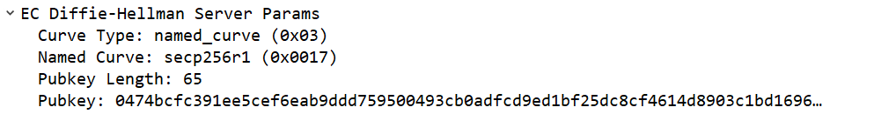
*(b) ECDH parameters inside the "`Server Key Exchange`" packet.*

*(c) ECDH parameters inside the "`Client Key Exchange`" packet.*\
**Figure 11.** *The information exchanged between the client and server when accessing the U. of C. Mathematics website.*

Looking at the data, we see the server sends to the client a point on the curve "`secp256r1`." This curve, which we denote \(E\), is equivalent to the standard NIST curve P-256 [21, p. 31], which is specified by the Weierstrass equation
\[ y^2 = x^3 - 3x + b, \qquad b \approx 4.105836 \times 10^{29}, \]
over the finite field \(\mathbb{F}_p\) with
\[ p = 2^{256} - 2^{224} + 2^{192} + 2^{96} - 1. \]
For the exact value of \(b\), see [22, p. 10]. Now, the public keys, labeled "`Pubkey`" in the images are the points \(A\) and \(B\) described in Algorithm 2.19. In this case, the TLS protocol represents the points as \(x\) and \(y\) coordinates in hexadecimal, with the 256 bits after "`0x04`" giving the value of \(x\), and the next 256 bits giving the value of \(y\). Decoding the values gives the following points, approximately:
\[ \begin{aligned} \text{server: } &\left(5.280220 \times 10^{29},\ 8.552703 \times 10^{29}\right) \\ \text{client: } &\left(8.646912 \times 10^{29},\ 6.480428 \times 10^{29}\right) \end{aligned} \]
A short calculation (using the exact values) will demonstrate that these points are indeed members of the group \(E(\mathbb{F}_p)\), as expected.


## Acknowledgements

First and foremost, I am indebted to my mentors Pawel Poczobut and Wei Yao for the guidance, feedback, and support they provided. I also thank Professor J. Peter May for organizing the University of Chicago REU, under whose auspices this paper was written.

## References

1. Joseph H. Silverman, *The Arithmetic of Elliptic Curves*, Springer, 2009.
2. William Fulton, *Algebraic Curves: An Introduction to Algebraic Geometry*, 2008.
3. Jennifer Park, Bjorn Poonen, John Voight, and Melanie Matchett Wood, *A heuristic for boundedness of ranks of elliptic curves* (2018), available at <https://arxiv.org/abs/1602.01431>.
4. Robin Hartshorne, *Algebraic Geometry*, Springer-Verlag, 1997.
5. M.F. Atiyah and I.G. Macdonald, *Introduction to Commutative Algebra*, Addison-Wesley, 1969.
6. Igor R. Shafarevich, *Basic Algebraic Geometry 1*, Springer, 2013.
7. Serge Lang, *Introduction to Algebraic and Abelian Functions*, Springer-Verlag, 1995.
8. J.S. Milne, *Elliptic Curves*, BookSurge Publishers, 2006.
9. J.W.S. Cassels, *Lectures on Elliptic Curves*, Cambridge, 1991.
10. David S. Dummit and Richard M. Foote, *Abstract Algebra*, Wiley, 2004.
11. Suhas V. Gondi, *An Elementary Proof of Mordell's Theorem* (2018), available at <http://math.uchicago.edu/~may/REU2018/REUPapers/Gondi.pdf>.
12. Huishi Yu, *A Proof of the Mordell-Weil Theorem* (2021), available at <http://math.uchicago.edu/~may/REU2021/REUPapers/Yu,Huishi.pdf>.
13. Igor R. Shafarevich and John T. Tate, *The Rank of Elliptic Curves*, Amer. Math. Soc. Transl. 8 (1967), 917–920.
14. Joseph H. Silverman and John T. Tate, *Rational Points on Elliptic Curves*, Springer, 2015.
15. Spencer Dembner, *Torsion on Elliptic Curves and Mazur's Theorem* (2019), available at <http://math.uchicago.edu/~may/REU2019/REUPapers/Dembner.pdf>.
16. Barry Mazur, *Modular curves and the Eisenstein ideal*, Inst. Hautes Études Sci. Publ. Math. 47 (1977), 33–186.
17. Noam D. Elkies and Zev Klagsbrun, *New rank records for elliptic curves having rational torsion*, Proceedings of the Fourteenth Algorithmic Number Theory Symposium, Mathematical Sciences Publishers, Berkeley, 2020, pp. 233–250.
18. Neal Koblitz, *A Course in Number Theory and Cryptography*, Springer-Verlag, 1994.
19. Neal Koblitz, *Elliptic Curve Cryptosystems*, Mathematics of Computation 48 (1987), no. 177, 203–209.
20. Don Johnson, Alfred Menezes, and Scott Vanstone, *The Elliptic Curve Digital Signature Algorithm (ECDSA)*, International Journal of Information Security 1 (2001), 36–63.
21. Yoav Nir, Simon Josefsson, and Manuel Pégourié-Gonnard, *Elliptic Curve Cryptography (ECC) Cipher Suites for Transport Layer Security (TLS) Versions 1.2 and Earlier*, RFC 8422 (2018), DOI 10.17487/RFC8422, available at <https://www.rfc-editor.org/info/rfc8422>.
22. Lily Chen, Dustin Moody, Andrew Regenscheid, and Karen Randall, *Recommendations for Discrete Logarithm-based Cryptography: Elliptic Curve Domain Parameters*, 2019, DOI 10.6028/NIST.SP.800-186.
